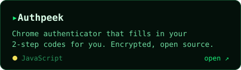
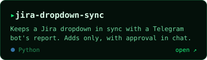
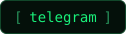
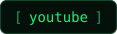
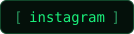

  <a href="https://github.com/LazizjanAsatov">
    <picture>
      <source media="(max-width: 600px)" srcset="assets/header-mobile.svg">
      
    </picture>
  </a>

  <a href="https://github.com/LazizjanAsatov?tab=repositories">
    <picture>
      <source media="(max-width: 600px)" srcset="assets/about-mobile.svg">
      
    </picture>
  </a>

  
  

  
  
  
  
  

